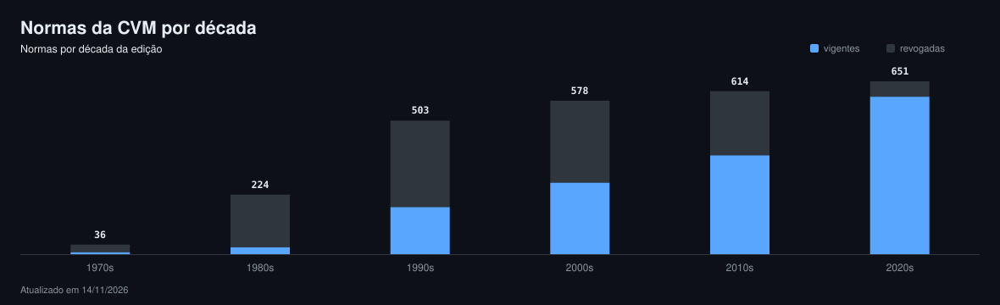

# Normas da CVM em Markdown

Todas as normas da Comissão de Valores Mobiliários, convertidas das fontes oficiais para Markdown, com
cabeçalho estruturado e link para a origem de cada texto: resoluções, instruções, deliberações, pareceres
de orientação, ofícios-circulares, notas explicativas, decisões conjuntas e portarias, de 1977 até hoje.
As contagens do acervo publicado são atualizadas a cada coleta, aqui e em **[COBERTURA.md](COBERTURA.md)**.

O objetivo é ter **toda a regulação do mercado de capitais** num lugar só, em texto simples, de graça,
para qualquer pessoa e para qualquer IA ler: cada norma com a situação (vigente ou revogada), quem a
revogou, o que a alterou, os temas e o arquivo oficial de onde o texto saiu.

Faz par com [normas-bcb](https://github.com/BrunooMoniz/normas-bcb) (Banco Central e CMN) e segue o
formato do [ctresb/leis](https://github.com/ctresb/leis), que reúne a legislação brasileira. As leis do
mercado de capitais (Lei 6.385/1976, Lei 6.404/1976 e as demais) estão lá, em `federal/`; aqui ficam só
os atos da CVM.

> [!IMPORTANT]
> Os textos têm caráter informativo e **não substituem a publicação no Diário Oficial da União** nem o
> portal da CVM. São conversões automáticas, com OCR nos documentos escaneados. Confira sempre a fonte
> indicada no cabeçalho antes de citar.

---

## Acervo

<!-- acervo:inicio -->
[](COBERTURA.md)

### Por série

| Série | No índice oficial | Publicadas | Vigentes | Revogadas | Período |
| --- | ---: | ---: | ---: | ---: | ---: |
| [Deliberações CVM](deliberacoes/) | 908 | 908 | 482 | 426 | 1978 a 2026 |
| [Instruções CVM](instrucoes/) | 627 | 627 | 8 | 619 | 1978 a 2020 |
| [Ofícios-Circulares](oficios-circulares/) | 601 | 601 | 601 | 0 | 1996 a 2026 |
| [Resoluções CVM](resolucoes/) | 251 | 251 | 233 | 18 | 2020 a 2026 |
| [Notas Explicativas](notas-explicativas/) | 77 | 77 | 6 | 71 | 1977 a 2022 |
| [Portarias CVM](portarias/) | 65 | 65 | 53 | 12 | 2001 a 2026 |
| [Pareceres de Orientação](pareceres-de-orientacao/) | 41 | 41 | 41 | 0 | 1978 a 2023 |
| [Decisões Conjuntas](decisoes-conjuntas/) | 34 | 34 | 18 | 16 | 1990 a 2024 |
| [Portarias Conjuntas](portarias-conjuntas/) | 2 | 2 | 2 | 0 | 2018 a 2018 |
| **Total** | **2.606** | **2.606** | **1.444** | **1.162** |  |

Vigentes são as que o portal não marca como revogadas nem canceladas.

### Por década



### Temas mais frequentes

| Temas | Normas |
| --- | ---: |
| Ofício Circular | 113 |
| Normas Contabeis | 109 |
| Companhia | 77 |
| Ofertas Publicas | 46 |
| Fundos de Investimento | 39 |
| Intermediários | 24 |
| Companhias Abertas | 22 |
| Mercados Organizados | 21 |
| Administradores de Carteiras | 16 |
| Fundos de Investimento em Direitos Creditórios | 14 |
| Infraestrutura do Mercado | 12 |
| Sandbox Regulatório | 11 |
| Fundos de Investimento Imobiliários | 11 |
| Ritos Processuais | 9 |
| Taxas/Débitos/Restituições | 9 |

_Números de 12/11/2026, gerados por `scripts/readme.py`._
<!-- acervo:fim -->

O que ficou de fora e por quê está em [COBERTURA.md](COBERTURA.md) e, linha por linha, em
[`_falhas.jsonl`](_falhas.jsonl).

## Fonte

Tudo vem do [portal de legislação da CVM](https://conteudo.cvm.gov.br/legislacao/index.html): o índice sai
da busca oficial de cada categoria e o texto, do arquivo publicado na página de cada norma (HTML, DOCX ou
PDF). Nada é digitado à mão.

---

## Estrutura

```
resolucoes/AAAA/resolNNN.md                 Resoluções CVM (2020 em diante)
instrucoes/AAAA/instNNN.md                  Instruções CVM (1978 a 2020; substituídas pelas resoluções)
deliberacoes/AAAA/deliNNN.md                Deliberações CVM
pareceres-de-orientacao/AAAA/pareNNN.md     Pareceres de Orientação
oficios-circulares/AAAA/oc-<area>-NNAA.md   Ofícios-Circulares das superintendências (SIN, SEP, SNC...); nome repetido em subpastas ganha a subpasta no fim (-sse1)
notas-explicativas/AAAA/*.md                Notas explicativas das instruções e resoluções
decisoes-conjuntas/AAAA/*.md                Decisões e resoluções conjuntas BCB/CVM
portarias/AAAA/*.md                         Portarias CVM
portarias-conjuntas/AAAA/*.md               Portarias conjuntas (CADE, Ministério da Fazenda)
scripts/cvm.py                              o código que baixa, converte e mede
COBERTURA.md                                números por categoria e lacunas
progresso.svg  decadas.svg                 o painel de progresso e o gráfico por década
scripts/readme.py                           gera os números deste README
_falhas.jsonl                               o que não entrou, linha por linha, e por quê
```

`AAAA` é o ano da norma. Fora do versionamento, porque o script os reproduz: `_fonte/` (HTML, DOCX e
PDF originais) e `_indice/` (o índice de cada categoria).

## Formato dos arquivos

```markdown
---
titulo: "Instrução CVM 409 (Revogada)"
orgao: "Comissão de Valores Mobiliários"
tipo: "Instrução CVM"
numero: "409"
data: 2004-08-18
ementa: "Dispõe sobre a constituição, a administração, o funcionamento e a divulgação de informações dos fundos de investimento."
revogada: true
revogada_por: "Instrução 555/14"
versao_texto: "texto consolidado sem marcas"
publicacao: "Publicada no DOU de 24.08.04; Republicada no DOU de 08.02.13 – texto consolidado sem marcas/Retificada no DOU de 14.06.13"
notas: "ALTERADA pelas Instruções 411/04 ; 413/04 ; 450/07 ; 456/07 ; 465/08 ; 512/11 ; 522/12 ; 524/12 ; 536/13 ; 549/14 . REVOGADO o art. 74 pela Instrução 522/12 . REVOGADA pela Instrução 555/14 ."
fonte: "https://conteudo.cvm.gov.br/legislacao/instrucoes/inst409.html"
arquivo: "https://conteudo.cvm.gov.br/export/sites/cvm/legislacao/instrucoes/anexos/400/inst409consolidsemmarcas.pdf"
sha256_arquivo: 4e179bb03f73dd1418411e4462d3b7399b2e4df22be86a6431af15a970c520ba
baixado_em: 2026-11-10
---
# Instrução CVM 409 (Revogada)

INSTRUÇÃO CVM N.º 409, DE 18 DE AGOSTO DE 2004.
...
```

`titulo`, `orgao`, `tipo`, `numero`, `data`, `revogada`, `versao_texto`, `fonte` e `baixado_em` existem em
todos os arquivos; os demais aparecem quando o portal os informa. `ocr: true` marca texto lido por OCR.

Quando o portal oferece mais de uma versão, o texto vem desta ordem de preferência: consolidado sem marcas,
consolidado, redação original. Entre formatos, HTML, depois DOCX, depois PDF (o `.doc` antigo não é lido).
`versao_texto` diz qual foi usada e `arquivo` aponta o arquivo exato, com o SHA-256 do que foi baixado.

## Reproduzir e atualizar

Precisa de [uv](https://docs.astral.sh/uv/) e do `pdftotext` (poppler); o OCR usa `tesseract`.

```
uv run scripts/cvm.py                 # tudo (retoma de onde parou; o que está em _fonte/ não é baixado de novo)
uv run scripts/cvm.py resolucoes      # uma categoria
uv run scripts/cvm.py --forcar        # baixa de novo, para pegar textos consolidados atualizados
uv run scripts/test_cvm.py            # testes
```

Fora do escopo: os Atos Declaratórios de alerta (avisos sobre pessoas e sites sem registro na CVM, que não
são regulação) e as decisões do Colegiado e processos sancionadores, que ficam em outras seções do portal.

## Licença

Código sob MIT. Os textos normativos são atos oficiais e não têm proteção de direito autoral
(Lei 9.610/1998, art. 8º, IV).
